  

  

  
  
  

  <i>"El código lo puede escribir cualquiera; entender qué problema resuelve y para quién, eso es lo que hace a un desarrollador."</i>

## 🧑‍💻 Sobre mí

  

- 📱 Me gusta crear apps **Android** con **Kotlin** y proyectos web completos
- 🗄️ Trabajo con bases de datos **SQL** y **MongoDB**
- 🐧 Fan de **Linux** y ex fan de **Windows** (aún le guardo cariño), y me apaño bien con máquinas virtuales

  

## 🛠️ Tecnologías

  
   
  

## 🚀 Proyectos destacados

  
  
  
  

## 📊 Estadísticas

  
  

  

  

